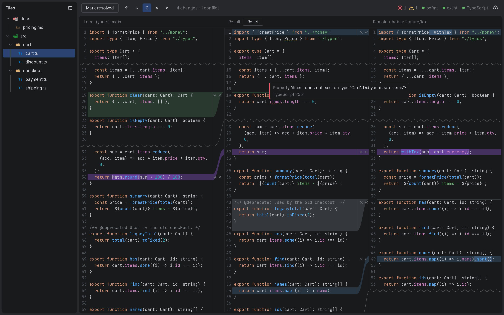

<!-- Generated by readmer from .readmer/readme.json. Edit the JSON, then run `readmer`. -->
<div align="center">

# yamt


_A three-way merge window like the one in JetBrains IDEs, for every git conflict at once. 🔀_

</div>

&nbsp;

## Why does this exist?
1. PhpStorm's three-pane merge window is the only merge tool I find usable. VS Code's merge editor, its extensions and the TUI mergetools all felt unintuitive.
2. They all start from the `<<<<<<<` conflict markers. Once git has collapsed a merge into markers the base is gone, so you can see _that_ two sides differ but not _what each side changed_. yamt never parses a conflict marker: it reads the base, your side and theirs from git's index and diffs them itself.
3. `git mergetool` opens one file at a time, and real merges touch many files. yamt takes over the whole merge: every conflicted file in one window, your side on the left, theirs on the right, the result in the middle.

## How it looks



## Install

Download from the [releases page](../../releases):

- **Linux**: the `.AppImage` or the `.deb`. The `.deb` (`sudo apt install ./yamt_0.3.0_amd64.deb`)
  puts `yamt` on your PATH. For the AppImage, put it there yourself.

  Without AppImageLauncher:

  ```sh
  install -Dm755 yamt_0.3.0_amd64.AppImage ~/.local/bin/yamt
  ```

  With AppImageLauncher (it stops a copy outside its folder with a dialog): let it integrate the
  AppImage (it moves the file to `~/Applications` and adds a hash to the name) and link the moved
  file:

  ```sh
  ail-cli integrate yamt_0.3.0_amd64.AppImage
  mkdir -p ~/.local/bin && ln -sf ~/Applications/yamt_0.3.0_amd64_*.AppImage ~/.local/bin/yamt
  ```

  If `yamt` is then not found, `~/.local/bin` is not on your PATH: add
  `export PATH="$HOME/.local/bin:$PATH"` to your shell's start-up file (`~/.bashrc`, `~/.zshrc`).

- **Arch Linux**: the AppImage, or build from source (below).
- **macOS**: the `.dmg`; drag yamt to Applications. The build is not signed, so the first time
  right-click yamt → Open, or run `xattr -d com.apple.quarantine /Applications/yamt.app`. Then put
  `yamt` on your PATH:

  ```sh
  sudo mkdir -p /usr/local/bin && sudo ln -s /Applications/yamt.app/Contents/MacOS/yamt /usr/local/bin/yamt
  ```

- **Windows 10/11**: the `_x64-setup.exe`; it installs for your user only, without admin rights.
  The build is not signed, so SmartScreen may warn: More info → Run anyway. yamt needs
  [Git for Windows](https://git-scm.com/download/win) (`git.exe` on your PATH). The installer does
  not put `yamt` on your PATH: add the folder its setup page installed to (under Windows'
  Environment Variables, user `Path`), then open a new terminal. yamt is a console program: run it
  from a terminal in the repository; started from the Start menu a console window opens beside it.

## Use

When `git merge`, `git rebase` or `git cherry-pick` stops with conflicts, run `yamt` in the repository (or `yamt --repo <path>` from anywhere). yamt starts from a terminal inside a repository; double-clicking it in a file manager or Finder shows nothing.

- The file list on the left shows every conflicted file with git's view of it (resolved or not, also when you run `git add` elsewhere); click one to open it. Drag its edge to make it wider. The button at the right of its "Files" header shows it as a tree, folders first with VS Code's folder icons, and back as a list (remembered after a restart). Ctrl+B (Cmd+B on macOS) hides and shows the list.
- The left pane's header names what is checked out: the branch, or the commit and its subject when no branch is (during a rebase). The right pane's header names what you are merging in: the branch, or the commit and its subject.
- Lines that no change touches are collapsed behind a wavy line across all three panes, keeping 4 lines next to each change, so every change of a file is in view with little scrolling. Click the wave (in any pane or between them) to show 4 more lines next to each change, again for 8 more, a third time for the rest. Searching for text in hidden lines shows them. The toolbar's "Collapse unchanged fragments" button turns collapsing off and on again for every open file.
- Each change has an arrow that applies it to the result and a × that ignores it; press one and drag up or down to apply or ignore several at once (one undo step). On a conflict, Ctrl+click (Cmd+click on macOS) on the arrow also ignores the other side, and on the × also takes the other side; holding Ctrl (Cmd) when releasing a drag does the same for every conflict it covers. Ctrl+click (Cmd+click) a highlighted change applies it, Ctrl+right-click (Cmd+right-click) ignores it. The toolbar applies all non-conflicting changes from the left or from the right in one click.
- From the keyboard: click a side or one of its changes (an outline shows which), then Enter or Space applies the change, Backspace, Delete or x ignores it, Up and Down move between the changes still waiting on that side, and Left and Right switch sides. The toolbar's up and down arrows do the same as Up and Down (on the left side when no side has the keyboard). Ctrl+scroll (Cmd+scroll on macOS) over a side steps through its changes. Ctrl+Z / Ctrl+Shift+Z (Cmd on macOS) undo and redo from anywhere in the window. These are the default keys; settings can change them.
- The result pane is a normal editor: type, Tab / Shift+Tab indent and outdent, undo and redo. Ctrl+F (Cmd+F) finds text in whichever pane you clicked.
- The gear at the toolbar's right end opens settings: **Dark** or **Light** colours, on Linux **Subpixel** (colour-edged text like WebStorm's, the default) or **Greyscale** antialiasing, every yamt shortcut — add, change or remove a key per action, or reset it (a key another action uses asks before moving) — and the language servers (below). Settings are saved per user in `~/.config/yamt/settings.json` (`~/Library/Application Support/yamt/settings.json` on macOS, `%APPDATA%\yamt\settings.json` on Windows) and hold only what you changed; point the settings page at another file, for example in your dotfiles, and yamt reads and writes that one, picking up your edits whenever its window gets focus.
- Ctrl+S (Cmd+S on macOS) saves the result to the file without staging it, so you can stop and come back later: changes still waiting are written as git wrote them (a conflict as its conflict markers), and yamt finds them again next time. A dot at the right end of the Result header shows unsaved work; closing the window asks only when something is not saved.
- **Mark resolved** writes the result, stages the file and opens the next unresolved one. It turns blue once nothing is left to process. **Reset**, next to "Result", brings the file back as it was when this run of yamt opened it.
- Right-click the toolbar to choose which of its icon buttons show (previous/next change, collapse unchanged fragments, apply all from either side, undo, redo; Undo and Redo start hidden). The choice applies to every file and is remembered after a restart; the keys work either way.
- A file deleted on one side and changed on the other shows the changed side with its changes, and two buttons: **Keep** and **Delete**. Other files the editor cannot show (binary, symlinks, submodules) get a choice between the two sides.
- Closing the window exits with status 0 when every file is resolved and 1 otherwise, so scripts can tell. Then continue as usual (`git commit`, `git rebase --continue`, …).

## Language servers

yamt runs the language servers your project already has, so the result pane shows their problems as you type: an underline, with the message on hover. It finds oxlint, oxfmt, TypeScript and eslint in the repository's projects and asks once per repository whether to start them; settings can change the answer. Left of the gear, each server shows its state; click one to start, stop or restart it or to read its log. A server that needs a separate package (typescript-language-server for TypeScript 5 and 6, vscode-langservers-extracted for eslint) shows "Not installed" with the install command for your package manager; yamt starts it when you come back to the window. With a formatter running (oxfmt, or an added server that formats), Ctrl+S formats the result before saving and leaves changes that still wait as they are. yamt ships no language server.

Other servers are added in settings under **Language servers → Added by you**: a command and the file types it serves. For Python with ruff, for example: command `ruff server`, file types `py, pyi`. yamt looks for the command in `node_modules/.bin` at the repository root, then on the PATH of the terminal it was started from; a command with a `/`, such as `.venv/bin/ruff server`, is read from the repository root. An added server is offered in every repository and runs where the repository's answer is Start; press **Start** under "This repository" if it is not.

## Make it feel built in

```sh
git config --global alias.resolve '!yamt'
git resolve
```

`git mergetool` is not the way to start yamt: it runs the tool once per file, while yamt handles all files in one window.

## Build from source

You need the Rust toolchain from `rust-toolchain.toml` (installed by [rustup](https://rustup.rs) on the first `cargo` call), [pnpm](https://pnpm.io), and on Linux webkit2gtk-4.1 (Arch: `webkit2gtk-4.1`; Debian/Ubuntu: `libwebkit2gtk-4.1-dev`).

```sh
cargo install tauri-cli --version 2.12.1
pnpm -C frontend install
cargo tauri build
```

The bundles land in `target/release/bundle/`.

## NVIDIA on Linux

WebKitGTK's DMABUF renderer crashes on some NVIDIA setups. yamt switches it off by itself when the NVIDIA driver is loaded; a value you set for `WEBKIT_DISABLE_DMABUF_RENDERER` wins.

## License

MIT, see [LICENSE](LICENSE). Bundled third-party software: [THIRD_PARTY_NOTICES.md](THIRD_PARTY_NOTICES.md) (summary) and [THIRD_PARTY_LICENSES.txt](THIRD_PARTY_LICENSES.txt) (every copyright line and licence text; also inside each download).
