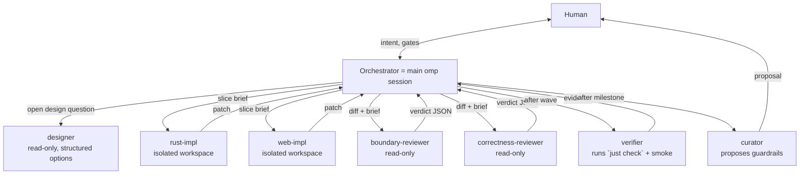

# AI development system — hierarchical agents, skills, hard gates

How the merge tool gets built mostly by agents without turning into mush. Built on omp
primitives that exist today (verified against the harness docs: `skills.md`,
`task-agent-discovery.md`, `tools/task.md`, `extensions.md`, `hooks.md`, `settings.md`).
Everything lives in the repo under `.omp/` (decided). One model tier (Opus) for every role
(decided). Human gates the orchestrator; the orchestrator proposes guardrail changes; the
human approves them; the system evolves.

---

## 1. Principles

1. **Rules must be enforceable or they are suggestions.** Every rule gets a level on the
   enforcement ladder (§7). Prose is the lowest and is temporary.
2. **Progressive disclosure, not a giant AGENTS.md.** `AGENTS.md` ≤ 25 lines. Layer-specific
   knowledge is in skills, loaded only by the agent that needs it (`autoloadSkills` in agent
   frontmatter) — a Rust implementer never carries Vue rules in context.
3. **Separation of powers.** Whoever writes code does not review it, does not certify it, and
   does not decide what "done" means. Orchestrator plans and never edits source; implementers
   edit only their slice; reviewers are read-only; the verifier runs the gate.
4. **One owner per file per wave.** Slices are disjoint by construction; the hook rejects
   anything else. Parallelism comes from disjointness, not from merging.
5. **Contracts are generated or type-checked, never prose.** IPC via generated bindings;
   module fences via ESLint/clippy/cargo graph; architecture decisions as a numbered record
   that agents may not relitigate.
6. **Durable state lives in files, not chat.** `docs/slices/SLICES.md` is the board,
   `.omp/GUARDRAILS.md` is the rule registry, `.omp/run/findings.jsonl` is the review log. A new
   session is handed these, not a transcript.
7. **The system is a product too.** It has a changelog, a budget, and retirement — see §8.

---

## 2. Hierarchy



Depth is 1: `task.maxRecursionDepth: 1`; no agent spawns agents. The orchestrator is the
only planner. This is deliberate: nested planning is where intent drifts.

---

## 3. omp mechanisms used, and for what

| mechanism | used for | config |
|---|---|---|
| project agents `.omp/agents/*.md` | roles with restricted `tools`, `autoloadSkills`, `output` schema, `spawns: ""` | per-file frontmatter |
| project skills `.omp/skills/<name>/SKILL.md` | layer knowledge, protocols, checklists; read on demand via `skill://` or autoloaded | `description` required (native provider) |
| hooks `.omp/hooks/pre/*.ts` | hard fences on `tool_call` (ownership, generated files, orchestrator no-code, dangerous bash) | `ctx.agent.kind` / `ctx.agent.id` distinguish main vs subagent |
| hooks `.omp/hooks/post/*.ts` | format-on-edit (`rustfmt`, `prettier`) via `tool_result` on `edit`/`write` | — |
| task isolation | each implementer in its own workspace; patch captured and applied back only on success | `task.isolation.enabled: true`, `isolation.merge: patch`, `isolation.apply: true` |
| `outputSchema` | reviewer / verifier / designer return JSON the orchestrator can act on mechanically | per agent `output` |
| `modelRoles` | one place to swap models per role | `.omp/config.yml` |
| `AGENTS.md` (root + per-crate) | 25-line entry point; per-directory 3-liners naming the owning skill | depth-merged by omp |
| `task.disabledAgents` | disable bundled `task`/`sonic` so nobody spawns a generic unconstrained worker | config |

### `.omp/config.yml`

```yaml
modelRoles:
  orchestrator: anthropic/claude-opus-5-5:high     # confirm exact selector with /model
  implementer:  anthropic/claude-opus-5-5:medium
  reviewer:     anthropic/claude-opus-5-5:high
  verifier:     anthropic/claude-opus-5-5:low
task:
  maxRecursionDepth: 1
  isolation: { enabled: true, merge: patch, apply: true }
  disabledAgents: [task, sonic]        # scout stays: orchestrator may use it for mapping
tools:
  approval:
    bash: ask                           # hooks allow-list the safe commands below
```

---

## 4. Agent roster (`.omp/agents/`)

Frontmatter sketches; bodies are ≤ 40 lines and point to skills.

```md
--- designer.md
name: designer
description: Produce 2–3 concrete design options for an open slice; read-only; cites files.
model: "@reviewer"
tools: [read, grep, glob, web_search, lsp]
spawns: ""
autoloadSkills: [project-map, decision-record]
output: { options: [{ name, summary, files_touched, risks, tests }], recommendation, open_questions }
```

```md
--- rust-impl.md
name: rust-impl
description: Implement one Rust slice inside its declared file ownership; runs no gate mid-flight.
model: "@implementer"
tools: [read, edit, write, grep, glob, bash, lsp]
spawns: ""
autoloadSkills: [project-map, slice-protocol, principles, rust-conventions]
output: { summary, files_changed, tests_added, smoke_evidence, deviations_from_brief, open_risks }
```

```md
--- web-impl.md        (same shape; autoloadSkills: [project-map, slice-protocol, principles, ts-conventions, vue-conventions, cm6-rules])
```

```md
--- boundary-reviewer.md
name: boundary-reviewer
description: Reviews a diff for architecture, ownership, naming, dead weight, contract drift. Read-only.
model: "@reviewer"
tools: [read, grep, glob, lsp]
spawns: ""
autoloadSkills: [project-map, review-protocol]
output: { verdict: "pass|fail", checked: [string], findings: [{ file, line, severity: "block|should|nit", rule_id?, problem, fix }] }
```

```md
--- correctness-reviewer.md   (same shape; autoloadSkills: [review-protocol, risk-register]; focus: edge cases, invariants, tests that would catch consumer-visible bugs, missing cases from the risk register)
```

```md
--- verifier.md
name: verifier
description: Runs `just check` and the slice's smoke recipe; reports evidence; changes nothing.
model: "@verifier"
tools: [read, bash, grep, glob]
spawns: ""
autoloadSkills: [verification]
output: { gate: "pass|fail", failures: [{ step, excerpt }], smoke: [{ recipe, observed, pass }] }
```

```md
--- curator.md
name: curator
description: Turns review findings and incidents into guardrail proposals (lint/test/hook/skill line). Edits only .omp/**.
model: "@reviewer"
tools: [read, grep, glob, edit, write]
spawns: ""
autoloadSkills: [guardrail-evolution]
output: { proposals: [{ id, origin_findings, rule, level, detector, cost, diff_summary }] }
```

Orchestrator = the main session. No agent file; its playbook is `skill://orchestrate`, which
`AGENTS.md` tells it to read first. The no-code hook makes delegation mandatory.

---

## 5. Skill roster (`.omp/skills/`)

Budget: each `SKILL.md` ≤ 120 lines; a rule line has the form
`- [R<id>] <rule>. Violation: <one-line example>. Detector: <lint|test|hook|review>`.
Over budget ⇒ promote or delete before adding.

| skill | content | autoloaded by |
|---|---|---|
| `project-map` | the §1–§5 of architecture.md condensed: tree, dependency graph, state-ownership table, "where does X go" table, pointer to decision record. Header: `verified against commit <sha>` | everyone |
| `decision-record` | the plan's §2 table + rule "do not relitigate without new information; propose an ADR instead" + ADR template | designer, orchestrator |
| `slice-protocol` | what a brief contains, what "done" means, output contract, non-goals discipline, "run `just check` once, at the end", how to report deviations instead of silently widening scope | implementers |
| `rust-conventions` | house rules (readable-by-a-beginner list from architecture §7, error types, module layout, clippy config, test placement, proptest/insta, `gitio` subprocess rules) + a **curated subset** of `leonardomso/rust-skills` (MIT) vendored under `references/`: keep `own-*`, `err-*`, `name-*`, `type-*`, `proj-*`, `lint-*`, `anti-*`; **drop** `mem-*`, `opt-*`, `async-*`, `perf-*` (premature optimisation and dependencies for a tool that diffs 16 files), `api-builder/typestate/sealed/extension/non-exhaustive/prelude` (library-publishing idioms), `test-mockall/mock-traits` (we run real git), `doc-examples/errors/panics-section` (see comment policy) | rust-impl |
| `principles` | the four `cursor/plugins` pstack principle skills (MIT) merged into one ~100-line `SKILL.md`: `type-system-discipline`, `minimize-reader-load`, `foundational-thinking`, `redesign-from-first-principles`. The lenses every implementer and reviewer applies | implementers, reviewers, orchestrator |
| `ts-conventions` | `cursor/plugins` `typescript-best-practices` rule table (MIT) + house additions: brands for line spaces (`ipc/domain.ts`), exhaustiveness via tsgolint, `satisfies`, object args except per-frame paths (`connectors/`, `scrollSync`), structured `log.*` not `console.*`, deviation note on IPC parsing | web-impl, reviewers on frontend diffs |
| `vue-conventions` | `SKILL.md` = house rules only (SFC section order, `function` declarations, `useTemplateRef`, type-based `defineEmits`/`defineProps`, vueuse-first in `ui/` only, no provide/inject, split by responsibility not section count, `useAppStore()` singleton, Tailwind v4 + `editor/theme.css`, adaptable-composable pattern for `useMergeController`) + explicit overrides of the vendored skill. `references/` = `vuejs-ai/skills` `vue-best-practices` and `create-adaptable-composable` verbatim (MIT), read on demand via `skill://vue-conventions/references/…` | web-impl |
| `cm6-rules` | the CM6 contract: StateField + invertedEffects for status, `mapPos` sides, `sliceDoc` not `toString`, lineSeparator, read-only pane config, `lineBlockAt`, viewport-only rendering, scroll re-entrancy | web-impl, reviewers on frontend diffs |
| `ipc-contract` | how to change the IPC: Rust type → `just bindings` → commit; error enum rules; never hand-edit bindings | rust-impl, web-impl |
| `review-protocol` | checklist, severity rubric (`block` = correctness/boundary/contract; `should` = maintainability; `nit` never blocks), max 10 findings ranked, every finding has file:line + fix, `checked:` list is mandatory evidence, no restating the diff | reviewers |
| `risk-register` | plan §6 as a table with "test that proves it handled" column | correctness-reviewer |
| `verification` | `just check`, per-layer smoke recipes (CLI classify on goldens; `just dev-web` + Epiphany checklist; `just dev-app` on a scripted conflict repo), what counts as evidence | verifier, implementers |
| `orchestrate` | the loop (§6), intent-capture questions, slice-brief template, disjointness check, rework policy, escalation, board updates, session handoff | orchestrator (manual read) |
| `guardrail-evolution` | enforcement ladder, rule lifecycle, promotion criteria, registry format, retirement | curator, orchestrator |
| `comment-policy` | **open for refinement** (R-open-1). Current rule: a comment must carry information the code cannot: an external fact (git behaviour, WebKit quirk, CM6 API subtlety) with a reference, or a `///` one-liner on a public `merge-core` item. Never: what the code does, section headers, TODOs, commented-out code. Reviewer test for every comment: "delete it — is anything lost that a rename or extraction could not restore?" If no → `should` finding. Logged per milestone so the curator can see whether agents over- or under-comment and tighten accordingly | implementers, reviewers |

Vendored material always lives in `references/` and is read on demand; `SKILL.md` itself
stays within budget. Autoloaded total per implementer: rust-impl ≈ 330 lines, web-impl ≈ 420
lines (over by the `cm6-rules` skill — acceptable for M1, revisit at the M1 retro).

Per-directory `AGENTS.md` (3 lines each) in `crates/merge-core`, `crates/gitio`,
`frontend/src/editor`, `frontend/src/ui`: "Owner skill: `skill://rust-conventions`. This crate
may not depend on: … . Tests live in: …". omp merges them by depth so an implementer working in
`crates/gitio` sees exactly that.

Root `AGENTS.md` (complete):

```md
# yamt
3-way merge tool. Rust (diff3 + git) + Tauri + CodeMirror 6 + Vue 3. Decisions: docs/plan.md §2 — not up for debate.
Architecture: skill://project-map. Work board: docs/slices/SLICES.md. Rules registry: .omp/GUARDRAILS.md.

- Main session: you are the orchestrator. Read skill://orchestrate before anything else. You do not edit crates/ or frontend/.
- Subagents: your skills were autoloaded; the brief defines your file ownership; `just check` once, at the end.
- Gate for everything: `just check`. Browser engine of record: WebKit (Epiphany).
```

---

## 6. The loop (what `skill://orchestrate` prescribes)

```
0. Session start: read AGENTS.md → skill://orchestrate → docs/slices/SLICES.md → .omp/GUARDRAILS.md (changelog tail).
1. Intent capture (with human): restate goal, acceptance, non-goals; ask ≤ 3 questions that change the plan; write the result into SLICES.md under the milestone.
2. Slice map: for the next wave, list slices with owner agent, owned globs, read-only globs, fixed contracts (signatures/types), acceptance, smoke recipe. Check: globs pairwise disjoint; every contract either exists or is defined in the brief.
   ── HUMAN GATE A: approve the wave ──
3. Spawn the wave: one `task` call, `isolated: true`, `name` = slice id (e.g. `M0S1MergeCore`). Write .omp/run/slices.json { "<name>": { owned: [...], readonly: [...] } } BEFORE spawning (hook reads it).
4. Collect implementer outputs. Any `deviations_from_brief` non-empty → decide: accept (update brief in SLICES.md) or reject (rework).
5. Review: spawn boundary-reviewer + correctness-reviewer in parallel on each patch (patch path + brief). Append all findings to .omp/run/findings.jsonl with slice id.
6. Rework: `block` findings → revive the same implementer (parked agent) with the findings; max 2 rounds; then ── HUMAN GATE B (escalation) ──. `should` findings → fixed in the same rework or logged as a follow-up slice, never dropped silently. `nit` → log only.
7. Verify: spawn verifier once for the wave (after patches are applied). `gate: fail` → rework the owning slice (step 6), not a new slice.
8. Board: mark slices done with the verifier's evidence line. Commit per wave (caveman-commit style).
9. Milestone end: demo recipe for the human (the milestone's acceptance from the plan) + `docs/walkthroughs/M<n>.md` (what was built, the non-obvious Rust constructs and why — the human is a Rust beginner). ── HUMAN GATE C: milestone acceptance ──
10. Retro: spawn curator with findings.jsonl since last retro + any human corrections from this milestone. Present proposals. ── HUMAN GATE D: approve guardrail changes ── Curator applies approved ones; GUARDRAILS.md changelog updated; skills' "verified against commit" bumped.
```

Rules the orchestrator follows about *itself*:

- It never edits `crates/**` or `frontend/**` (hook-enforced), never runs `just check` as proof
  (the verifier does), never spawns a slice without a disjointness check.
- It may use `scout` to map code before planning; scout output is context, not a plan.
- Every human correction during a milestone ("don't do X", "I prefer Y") is written to
  `.omp/run/findings.jsonl` with `source: human` so the curator sees it at retro. This is the
  main input for evolution — the system learns from the human's corrections, not from its own
  opinions.
- It may recommend guardrails any time; it may not apply them without Gate D. Exception: a
  pure addition to `.omp/run/slices.json` or `SLICES.md`.
- **Questions to the human are product questions.** The human is the product owner (TS
  proficient, Rust beginner), not the type designer. Never ask "start/end or start/len?";
  ask "should X be possible for the user, at the cost of Y?" and decide the technical shape
  yourself, recording it in the decision record with the rationale. If a technical choice has
  no product-visible consequence, it is not a question at all. (First human correction,
  2026-10-08, logged as finding #1.)
- **Every technical decision cites a core vision** (architecture §0, also `skill://project-map`
  header). The decision record entry reads "chose X over Y because vision N"; a choice that
  cannot be traced to a vision is either irrelevant (pick the boring option) or a product
  question (ask, in product terms).

### Slice brief template (contract between orchestrator and implementer)

```
# Slice M1S2 — connector geometry
## Target
Owned: frontend/src/connectors/**          Read-only: frontend/src/ipc/bindings.ts, frontend/src/model/**
Non-goals: rendering, scroll sync, any DOM.
## Contract (fixed — do not change signatures)
export type Band = …; export function bandPath(b: Band, width: number): string; export function visibleBands(…): Band[]
## Change
1. … 2. … 3. …
## Acceptance (observable)
- `pnpm vitest run connectors` passes with ≥ these cases: empty chunk list; chunk above viewport; chunk spanning both viewports; 2k-line fixture snapshot.
- No import from vue/, editor/, ui/ (eslint boundaries passes).
## Skills
skill://frontend-conventions (autoloaded), skill://cm6-rules §geometry
## Report
Use the output schema. `deviations_from_brief` must list anything you did outside Change/Target.
```

---

## 7. Hard fences (`.omp/hooks/`)

All `pre/` hooks: `tool_call` handlers; fail closed; reason strings cite the rule id.

| hook | logic | protects against |
|---|---|---|
| `pre/ownership.ts` | if `ctx.agent.kind === "sub"`: look up `ctx.agent.id` in `.omp/run/slices.json`; `edit`/`write` path must match an `owned` glob; `bash` commands containing redirection into non-owned paths are blocked (regex, conservative). If `ctx.agent.kind === "main"`: block `edit`/`write` under `crates/**`, `frontend/**`, `src-tauri/**` | scope creep, two agents on one file, orchestrator "just fixing it" |
| `pre/generated.ts` | block `edit`/`write` on `frontend/src/ipc/bindings.ts`, `Cargo.lock`, `pnpm-lock.yaml`, `**/__snapshots__/**`, `tests/golden/**/expected.json` (goldens change only via `just golden-update`, run by a human or the verifier on request) | silent contract/golden drift |
| `pre/bash-guard.ts` | deny: `git push`, `git reset --hard`, `git checkout .`, `rm -rf` outside `target/` & `node_modules/`, `cargo publish`, `npm publish`, `curl … \| sh`; subagents additionally denied `git commit` (orchestrator commits per wave) | destructive mistakes; agent-authored commits with no review |
| `pre/skill-gate.ts` (optional, measure first) | first `edit` by an implementer whose context has not `read` its layer skill in this session → block with "read skill://… first" — only if `autoloadSkills` proves insufficient | ignoring conventions |
| `post/format.ts` | after a successful `edit`/`write` on `*.rs` → `rustfmt` that file; on `*.ts|*.vue` → `prettier --write` that file; returns `additionalContext` only if the formatter changed something | formatting noise in reviews |

Verify at bootstrap (§9) that `ctx.agent.id` equals the task item `name` — the docs say the
name "becomes the registry/IRC id"; confirm with a throwaway hook that logs `ctx.agent` once.
If it is not, key `slices.json` by `ctx.agent.name` (the agent definition) plus a slice id
passed in the brief and echoed by the agent into a marker file.

### Enforcement ladder (for `GUARDRAILS.md`)

| level | mechanism | examples |
|---|---|---|
| L0 | prose in a skill | "prefer `thiserror` enums over `anyhow` in library crates" |
| L1 | static: clippy, ESLint boundaries, tsc, cargo graph, cargo-deny | "ui/ never imports @codemirror" |
| L2 | test: proptest invariant, golden, arch test | "chunks are disjoint", "undo restores status" |
| L3 | hook: tool-call block | ownership, generated files, bash guard |

Promotion rule: an L0 rule that produces a `block` finding **twice** must be promoted to L1–L3
at the next retro or be deleted as unenforceable. An L1+ rule needs no prose beyond its id and
a one-line rationale (the detector *is* the rule).

`.omp/GUARDRAILS.md` format:

```
| id | rule | level | detector | origin | added | status |
| R12 | Vue state never holds EditorView/positions | L1 | eslint boundaries + no-restricted-imports | M1 retro, findings #31,#44 | 2026-xx | active |
```

plus a `## Changelog` section the curator appends to.

---

## 8. Evolution

- **Input:** `.omp/run/findings.jsonl` (reviewer findings, verifier failures, human corrections
  tagged `source: human`), and incidents (a hook block, a rework round 2, a Gate B escalation).
- **Retro per milestone** (Gate D). Curator clusters findings by rule, proposes per cluster:
  the cheapest detector that would have caught it (L1 before L2 before L3 before L0), a
  one-line diff summary to the skill/lint/test/hook, and the cost (lines added to context).
- **Budgets:** skills ≤ 120 lines each; total autoloaded context per implementer ≤ ~400 lines;
  `GUARDRAILS.md` ≤ 60 active rules. Over budget ⇒ the proposal must name what it retires.
- **Retirement:** a rule with no findings in two milestones and no detector is deleted; a
  rule whose detector has never fired in two milestones is reviewed for redundancy with a
  stronger one.
- **Drift check:** curator diffs `project-map` against the tree every retro (dirs, public
  types, dependency graph) and bumps `verified against commit`.
- **Human authority:** every change to `.omp/agents`, `.omp/skills`, `.omp/hooks`,
  `GUARDRAILS.md` goes through Gate D. The orchestrator can *recommend* at any time (and
  should, when a correction repeats); it never applies.

---

## 9. Bootstrap sequence

Session 1 (orchestrator + human, mostly human-driven):

1. Move plan + architecture into `docs/`; create `.omp/config.yml`, `AGENTS.md`, empty
   `SLICES.md`, `GUARDRAILS.md` with the L1 rules already implied by architecture §2.
2. Write skills from the architecture doc (`project-map`, `decision-record`, `slice-protocol`,
   `rust-conventions`, `frontend-conventions`, `cm6-rules`, `ipc-contract`, `review-protocol`,
   `risk-register`, `verification`, `orchestrate`, `guardrail-evolution`). Yes, the orchestrator
   drafts them; the human edits. This is the one time prose is written in bulk.
3. Write agents and hooks. **Smoke the fences** with throwaway tasks: an implementer told to
   edit a file outside its slice must be blocked; the main session editing `crates/` must be
   blocked; a hand-edit of `bindings.ts` must be blocked; log `ctx.agent` once to confirm the id
   mapping (§7). Delete throwaways.
4. Slice 0.0 (walking skeleton) as a single implementer; verifier confirms `just check` green
   on empty crates. This is also the first full run of the loop with trivial content —
   calibrate: were the briefs sufficient? did reviewers produce signal or noise?

Session 2+: M0 slices 0.1/0.1' in parallel, then 0.2, 0.3, Gate C with PhpStorm comparison,
first real retro.

---

## 10. Risks of the system itself

| risk | mitigation |
|---|---|
| over-constraint → agents hedge, stub, or report "blocked" | briefs carry acceptance, not procedure; `deviations_from_brief` is a legal channel; Gate B exists; retro deletes rules that only produce noise |
| review theater (rubber stamps or restated diffs) | mandatory `checked:` evidence list; `nit` cannot block; findings need file:line + fix; reviewers are measured at retro (findings that led to a real change vs. dropped) |
| context bloat from autoloaded skills | hard line budgets; per-layer autoload only; promote prose to detectors |
| skills drift from code | `verified against commit` + curator drift check every retro; project-map is a condensation of a doc that is itself checked by `just check` where possible (bindings, graph) |
| hook identity assumptions wrong | smoke in bootstrap step 3 before any real slice |
| parallel patches conflict at apply | disjoint globs enforced before spawn + at tool time; shared files (`Cargo.toml` workspace, `justfile`) are owned by the orchestrator's own edits between waves, never by implementers — brief says "report needed `Cargo.toml` changes in `deviations_from_brief`"; orchestrator applies them (its `.omp`/docs/config edit allowance covers `Cargo.toml`, `justfile`, `package.json`) |
| orchestrator context exhaustion mid-milestone | board + findings log are the handoff; `skill://orchestrate` step 0 re-hydrates a fresh session in one read |
| the human becomes the bottleneck at four gates | Gates A and C are the real ones; B only on escalation; D batched per milestone. If still too slow, collapse A into "auto-approve waves whose slices all have L1/L2 acceptance", gated by a config flag the human flips |
