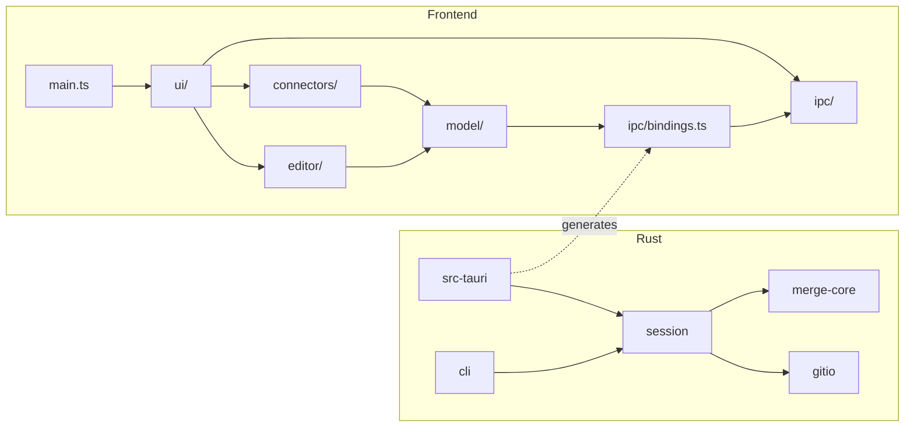

# 3-way merge tool — technical architecture

Companion to `docs/plan.md` (decisions, milestones, risks). That file is the
_what and why_; this one is the _how_: repository shape, module boundaries, contracts,
algorithms, toolchain, gates. Written so that every boundary here can be turned into a
lint, a test, a hook, or a skill — see `docs/ai-system.md`.

Decisions resolved since the plan: **frontend chrome = Vue 3**; **all AI tooling lives in
the repo under `.omp/`**; **one model tier (Opus) for every role**.

Name: `yamt`. Repository: `~/Projects/yamt`.

## 0. Core visions — every technical decision is derived from one of these

1. **Readable by the product owner.** TS-proficient, Rust beginner. Clever is a defect;
   a construct needs a reason a beginner can follow. Names and structure replace comments.
2. **One source of truth per fact.** Types generated, not mirrored; state owned by exactly
   one layer (§5.1); palette, gap constant, decisions — each lives in one place.
3. **Boundaries are enforced, not described.** Every rule in this document names its
   detector (lint, test, hook); a rule without one is temporary.
4. **Illegal states don't compile.** Branded line spaces, constructive ranges, exhaustive
   matches, sum types over flag bags — on both sides of the IPC.
5. **Small surface, boring design.** No abstraction without two concrete users; no
   dependency the stdlib or an already-chosen library covers; v0 scope stays v0.

When two visions conflict, the lower number wins. The orchestrator cites the vision when it
records a technical decision; a decision that cites none is a question for the human.

---

## 1. Repository layout

```
yamt/
├─ Cargo.toml                 workspace: members = crates/*, src-tauri
├─ justfile                   the ONLY task runner; CI runs `just check`
├─ rust-toolchain.toml        pinned stable
├─ deny.toml                  cargo-deny (licenses, bans, advisories)
├─ AGENTS.md                  ≤ 25 lines, points at skills (see ai-system doc)
├─ .omp/                      agents, skills, hooks, config.yml, GUARDRAILS.md
├─ docs/
│  ├─ plan.md                 moved from Desktop; decision record lives here
│  ├─ architecture.md         this file
│  └─ slices/SLICES.md        orchestrator's durable work board
├─ crates/
│  ├─ merge-core/             pure diff3 chunk model. NO I/O, NO git, NO tauri
│  ├─ gitio/                  git subprocess layer. NO merge logic
│  ├─ session/                MergeSession state machine; depends on merge-core + gitio
│  ├─ cli/                    headless binary (M0): classify / scan / golden tooling
│  └─ conflict-repo/          test-only: scripted conflict repos for gitio + session tests (dev-dependency)
├─ src-tauri/                 Tauri shell: commands + DTO export + DMABUF guard. Depends on session only
├─ frontend/
│  ├─ package.json            pnpm; Vite + Vue 3 + TS strict
│  ├─ src/
│  │  ├─ ipc/                 ChunkSource interface; TauriChunkSource; FixtureChunkSource
│  │  │  └─ bindings.ts       GENERATED from Rust (tauri-specta). Never hand-edited
│  │  ├─ model/               pure TS, framework-free: chunk state, scroll map, apply math
│  │  ├─ editor/              CodeMirror integration; exports ONLY MergeController
│  │  ├─ connectors/          pure geometry → SVG path strings
│  │  ├─ ui/                  Vue components + one store. Never imports @codemirror/*
│  │  └─ main.ts              wiring: pick ChunkSource, mount App
│  └─ fixtures/               JSON produced by `cli classify --json` from golden triples
└─ tests/golden/<case>/       base.txt local.txt remote.txt expected.json  (+ README per case)
```

Two toolchains, one entry point: `just check` runs every gate below (§8).

---

## 2. Dependency direction



Rules (each one is enforced, not advised — §8 says by what):

| rule                                                                                                                                                         | enforced by                                                                                                                     |
| ------------------------------------------------------------------------------------------------------------------------------------------------------------ | ------------------------------------------------------------------------------------------------------------------------------- |
| `merge-core` has no `std::process`, `std::fs`, `tokio`, `tauri`, `serde_json`                                                                                | clippy `disallowed_methods`/`disallowed_types` + no such deps in `Cargo.toml` (cargo-deny `bans` wildcard check per crate)      |
| `gitio` contains no diff logic (never depends on `merge-core`)                                                                                               | workspace `Cargo.toml` graph; `cargo tree -e normal -p gitio` must not list merge-core (just recipe)                            |
| `src-tauri` depends only on `session` + tauri crates; command bodies ≤ 15 lines (thin)                                                                       | dependency list; reviewer rule                                                                                                  |
| `ui/**` never imports `@codemirror/*`, `editor/internal/**`, `model/**` directly                                                                             | oxlint `no-restricted-imports` in a per-directory `overrides` block                                                             |
| `model/**` and `connectors/**` import nothing from `vue`, `@vueuse/*`, `editor/`, `ui/`, `@tauri-apps/*`; `editor/**` imports nothing from `vue`/`@vueuse/*` | oxlint `no-restricted-imports` overrides; `import/no-cycle` globally                                                            |
| `ipc/bindings.ts` is generated and byte-identical to `cargo run -p yamt-app --bin export-bindings` output                                                    | `just bindings-check` diff in CI; hook blocks `edit`/`write` on the path                                                        |
| No `unwrap`/`expect`/`panic!` outside tests in Rust                                                                                                          | clippy `unwrap_used`, `expect_used`, `panic` = deny; `#[cfg(test)]` allowed                                                     |
| No `any`, no non-null assertions, no `as` casts outside `ipc/fixture.ts`                                                                                     | oxlint `no-explicit-any`, `no-non-null-assertion`, `consistent-type-assertions: never` (override for the fixture parser)        |
| Every `switch` over a union is exhaustive; every Rust `match` over a domain enum lists all variants                                                          | oxlint type-aware `switch-exhaustiveness-check`; clippy `wildcard_enum_match_arm = deny`                                        |
| No magic numbers                                                                                                                                             | oxlint `no-magic-numbers` (ignore `0, 1, -1`); Rust: reviewer rule, constants in `merge_core::Options` and module-level `const` |
| Line numbers of different spaces never mix                                                                                                                   | Rust newtypes `BaseLine`/`LocalLine`/`RemoteLine`; TS brands applied in `ipc/` (§4)                                             |

---

## 3. Rust crates

### 3.1 `merge-core` — the IP

```rust
#![forbid(unsafe_code)]

/// 0-based line index in one specific document's line space. Newtypes so that a
/// base-space line can never be passed where a local-space line is expected.
pub struct BaseLine(pub u32);
pub struct LocalLine(pub u32);
pub struct RemoteLine(pub u32);

/// Constructive range: `start` + `len`, so an inverted range cannot be built.
pub struct LineRange<L> { pub start: L, pub len: u32 }
impl<L> LineRange<L> { pub fn end(&self) -> L; pub fn is_empty(&self) -> bool; }

pub enum ChunkKind { LocalOnly, RemoteOnly, BothSame, Conflict }

pub struct ChunkId(pub u32);  // index, stable for the file's lifetime

pub struct Chunk {
    pub id: ChunkId,
    pub kind: ChunkKind,
    pub base: LineRange<BaseLine>,     // may be empty (pure insertion)
    pub local: LineRange<LocalLine>,
    pub remote: LineRange<RemoteLine>,
}

pub struct Options { pub gap: u32 }
pub const DEFAULT_GAP: u32 = 1;   // tuned by goldens; the only tuning constant

pub fn compute_chunks(base: &str, local: &str, remote: &str, opts: &Options) -> Vec<Chunk>;

/// Expected merge text when every non-Conflict chunk is applied — used by tests and
/// by `cli classify` to cross-check against `git merge-file`.
pub fn apply_non_conflicting(base: &str, local: &str, remote: &str, chunks: &[Chunk]) -> String;
```

The chunk types (`BaseLine`, `LocalLine`, `RemoteLine`, `LineRange`, `ChunkKind`, `ChunkId`,
`Chunk`) derive `serde::Serialize` + `specta::Type` and cross the IPC as they are; `session` and
`src-tauri` reuse them instead of mirroring them (plan §2 #25). `apply_non_conflicting` keeps a
`Conflict` chunk's base lines (the result starts from base, plan §2 #9).

Algorithm (plan §4), made precise:

1. `d1 = diff(base, local)`, `d2 = diff(base, remote)` via `imara-diff` (histogram, then its
   `postprocess_lines` hunk placement; interned lines with terminators so a missing trailing
   newline is a real difference). Lines are split on `\n` only; `\r` stays in the line content,
   so CRLF↔LF shows up as a change, exactly as git sees it.
2. Each hunk → `{ base: LineRange, side: LineRange }`. Both lists are sorted by `base.start`.
3. Sweep: merge all hunks (both sides) in base order into regions. Open a region at the first
   hunk; absorb the next hunk if `next.base.start <= region.base.end + gap`. Two zero-length
   insertions at the same base line **always** merge (they are the classic add/add conflict).
4. For each region: side ranges are not the union of hunk side ranges — they are the base
   endpoints mapped through that side's edit script (`map_base_to_side(script, line)`), so a
   region that only one side touched still has a correct, possibly identical, range on the other
   side. This is what makes connectors and scroll anchors trivial.
5. Kind: hunks from one side only → `LocalOnly`/`RemoteOnly`; both → compare the side texts of
   the region; equal → `BothSame`, else `Conflict`.

Invariants (property-tested with `proptest`):

- chunks sorted by `base.start`, pairwise disjoint in base space, same for local and remote.
- `apply_non_conflicting` on a triple with zero `Conflict` chunks `==` `git merge-file -p`
  output (the CLI test harness shells out to git; `merge-core` itself never does).
- for any triple, every non-Conflict chunk's text on the "other" side equals the base text
  of that region (otherwise it is by definition a conflict).
- `local == base` ⇒ every chunk is `RemoteOnly`; `local == remote` ⇒ no `Conflict`.
- `base == ""` (add/add) with `local` and `remote` both non-empty ⇒ exactly one chunk, base range
  empty at line 0, `Conflict` unless `local == remote` (then `BothSame`).
- reconstruction: base with each chunk's base range replaced by its local lines `==` local,
  byte for byte; same for remote (proves the side-range mapping of step 4).

Not in `merge-core` v0: intra-line word diff. Add later as `pub fn word_diff(a:&str, b:&str)`
returning token ranges; it stays pure.

### 3.2 `gitio` — subprocess only

```rust
pub struct Repo { root: PathBuf, git: PathBuf /* resolved `git` */ }

pub struct Oid(String);                    // 40 or 64 hex chars; Oid::parse, as_str
pub enum Stage { Base, Local, Remote }     // index stages 1, 2, 3 — no stage 0 or 4 can be built
pub struct StageEntry { pub mode: u32, pub oid: Oid, pub stage: Stage, pub path: PathBuf }

impl Repo {
    pub fn discover(cwd: &Path) -> Result<Repo>;                 // rev-parse --show-toplevel
    pub fn root(&self) -> &Path;
    pub fn unmerged(&self) -> Result<Vec<StageEntry>>;            // ls-files -u -z
    pub fn blob_reader(&self) -> Result<BlobReader>;              // cat-file --batch, long-lived
    pub fn restore_stages(&self, entries: &[StageEntry]) -> Result<()>; // update-index -z --index-info
    pub fn checkout_merge(&self, path: &Path) -> Result<()>;      // checkout -m -- <path>
    pub fn add(&self, path: &Path) -> Result<()>;                 // add -- <path>
}
impl BlobReader { pub fn read(&mut self, oid: &Oid) -> Result<Vec<u8>>; }
```

- Every git call: explicit argv, `-c core.quotepath=false`, `LC_ALL=C`, `GIT_OPTIONAL_LOCKS=0`
  for reads, cwd = repo root, timeouts, stderr captured into the error.
- Bytes in, bytes out. No UTF-8 assumptions here; `session` decides.
- Integration tests build real repos in `tempdir` with a scripted conflict (crate
  `yamt-conflict-repo`, `conflict_repo(files)`, shared with `session`'s tests), including
  add/add, delete/modify, and a CRLF file. These tests are the only place `git` runs during `just check`.

### 3.3 `session` — the state machine

```rust
pub struct MergeSession { repo: Repo, files: Vec<FileState> /* private: captured stages + decoded content */ }

pub enum Eol { Lf, CrLf, Mixed }
pub enum FileStatus { Unresolved, Resolved }
pub enum UnsupportedReason { Binary, NonUtf8, TooLarge, LocalDeleted, RemoteDeleted, Symlink, Submodule }

// DTOs (serde::Serialize + specta::Type), see §4
pub struct FileEntry { pub path: String, pub status: FileStatus, pub unsupported: Option<UnsupportedReason> }
pub struct FileMergeData { pub path: String, pub base: String /* "" for add/add */, pub local: String,
                           pub remote: String, pub eol: Eol, pub language: Option<String>, pub chunks: Vec<Chunk> }

impl MergeSession {
    pub fn open(cwd: &Path) -> Result<Self>;                         // captures every file's stages and decodes its blobs now
    pub fn files(&self) -> Vec<FileEntry>;
    pub fn load(&mut self, path: &str) -> Result<FileMergeData>;     // decoded texts + compute_chunks
    pub fn finish(&mut self, path: &str, result: &str) -> Result<()>; // write worktree bytes as given, git add, Resolved
    pub fn reset(&mut self, path: &str) -> Result<()>;               // restore_stages (+ checkout -m when both sides exist), Unresolved
    pub fn remaining(&self) -> usize;
}
```

Edge cases owned here (plan §6 → code):

| case                                                           | handling                                                                                                                                                                                                                    |
| -------------------------------------------------------------- | --------------------------------------------------------------------------------------------------------------------------------------------------------------------------------------------------------------------------- |
| no stage 1 (add/add)                                           | `base = ""`; chunk model yields one Conflict                                                                                                                                                                                |
| no stage 2 or 3 (delete/modify)                                | `unsupported: LocalDeleted / RemoteDeleted` in v0; UI offers "keep file" / "delete file" via `git add`/`git rm` — **v0.1, not v0**                                                                                          |
| binary (NUL in first 8000 bytes, git's heuristic) or non-UTF-8 | `unsupported: Binary / NonUtf8`; UI shows reason, offers "take local" / "take remote" (`git checkout --ours/--theirs` + add) — **v0.1**                                                                                     |
| line endings                                                   | `Eol` detected on base (or local if base empty): `Lf`, `CrLf`, `Mixed`; `finish` writes text as given by the frontend (frontend joins with the configured separator); `Mixed` is passed through untouched with a UI warning |
| `git add` destroys stages                                      | `stages` captured in `open()`; `reset` replays them                                                                                                                                                                         |
| file > 8 MiB                                                   | `Unsupported(TooLarge)` — CM6 handles it, the webview IPC does not enjoy it; revisit                                                                                                                                        |

### 3.4 `cli`

```
yamt-cli classify <base> <local> <remote> [--gap N] [--json]   # chunk table or FileMergeData JSON
yamt-cli scan [<repo>]                                         # unmerged files + per-file summary
yamt-cli golden run|update                                     # insta snapshots over tests/golden
yamt-cli fixture <case> > frontend/fixtures/<case>.json        # M1 input, same DTO as IPC
```

M0 acceptance lives here: `golden run` passes, `classify --json` on each golden matches
`expected.json`, and the human compares ~10 real-world goldens against PhpStorm once.

### 3.5 `src-tauri`

- One `tauri::State<Mutex<MergeSession>>`.
- Commands (thin, typed with `tauri-specta`; fallback `ts-rs` if specta lags Tauri):
  `list_files() -> Vec<FileEntry>`, `load_file(path) -> FileMergeData`,
  `finish_file(path, text) -> Vec<FileEntry>`, `reset_file(path) -> FileMergeData`,
  `quit_if_done() -> bool`.
- Errors: one `#[serde(tag = "kind")] enum IpcError` mirrored into TS; no stringly errors.
- `main()`: DMABUF guard (plan §3) **before** `tauri::Builder`; CLI args: `--repo <path>`;
  exit code 0 iff `remaining() == 0` at close.
- `export-bindings` bin writes `frontend/src/ipc/bindings.ts`.

---

## 4. IPC contract (generated, the single source of truth)

```ts
// bindings.ts — GENERATED
export type LineRange<L> = { start: L; len: number };     // L is a branded number
export type ChunkKind = "LocalOnly" | "RemoteOnly" | "BothSame" | "Conflict";
export type Chunk = { id: ChunkId; kind: ChunkKind; base: LineRange<BaseLine>; local: LineRange<LocalLine>; remote: LineRange<RemoteLine> };
export type Eol = "Lf" | "CrLf" | "Mixed";
export type UnsupportedReason = "Binary" | "NonUtf8" | "TooLarge" | "LocalDeleted" | "RemoteDeleted" | "Symlink" | "Submodule";
export type FileEntry = { path: string; status: "Unresolved" | "Resolved"; unsupported: UnsupportedReason | null };
export type FileMergeData = { path: string; base: string; local: string; remote: string; eol: Eol; language: string | null; chunks: Chunk[] };
export const commands: { listFiles(): Promise<FileEntry[]>; loadFile(path: string): Promise<FileMergeData>; … };
```

Brands: specta emits the Rust newtypes as plain `number`, so the generated DTOs are
unbranded. `ipc/domain.ts` owns the domain types (`BaseLine = number & { readonly __space:
"base" }`, `LocalLine`, `RemoteLine`, `ChunkId`, and `Chunk`/`FileMergeData` built on them)
and one `toDomain(dto: Generated.FileMergeData): FileMergeData` mapping. Both `ChunkSource`
implementations return domain types; nothing outside `ipc/` sees a generated DTO. `DocPos`
(a CodeMirror offset) is a fourth brand created only inside `editor/`. Mixing any two is a
type error, which is the point: base-vs-local-vs-doc confusion is the merge tool's native bug.

Runtime parsing: Tauri payloads come from our own Rust at the same commit through generated
types — trusted, no runtime parse (deliberate deviation from parse-at-boundary). Fixture JSON
is external and is parsed with `valibot` in `ipc/fixture.ts`, the only file allowed `as`.

Logging crosses the boundary too: `commands.log(entry: LogEntry)` where
`LogEntry = { level: "debug"|"info"|"warn"|"error"; event: string; fields: Record<string, string | number | boolean> }`.
Frontend code calls `log.warn("scroll.drift", { lines })` on the one logger that `ipc/` creates
with `createLog(forward)` (`log.ts` exports the factory, not an instance); `log.ts` is the only file that
may touch `console.*` (oxlint `no-console` with a file override): every entry is mirrored to
the webview console as a structured line (`[warn] scroll.drift {lines: 3}`) so devtools in
Epiphany/Tauri show it live, and forwarded to Rust fire-and-forget. Rust forwards to
`tracing`; `--log <file>` / `YAMT_LOG` select sink and level. Debug level is console-only
unless `import.meta.env.DEV`; the IPC call never blocks or throws into caller code.

Workflow for changing it: edit Rust types → `just bindings` → commit both. Hand edits are
blocked by a hook and caught by `just bindings-check`.

`frontend/src/ipc/ChunkSource.ts`:

```ts
export interface ChunkSource {
  listFiles(): Promise<FileEntry[]>;
  loadFile(path: string): Promise<FileMergeData>;
  finishFile(path: string, text: string): Promise<FileEntry[]>;
  resetFile(path: string): Promise<FileMergeData>;
}
```

`FixtureChunkSource` (M1) reads `fixtures/*.json`; `finishFile` stores results in memory and
logs the text. `TauriChunkSource` (M2) wraps `commands`. `main.ts` picks one by
`import.meta.env.VITE_CHUNK_SOURCE`.

---

## 5. Frontend modules and fences

### 5.1 State ownership — the table that prevents the classic mistake

| state                                                                           | owner                                                                               | why                                                |
| ------------------------------------------------------------------------------- | ----------------------------------------------------------------------------------- | -------------------------------------------------- |
| left/right/center document text                                                 | CodeMirror `EditorState`                                                            | rope, transactions, undo                           |
| chunk current positions in center                                               | `editor/chunkField` (`StateField`)                                                  | remapped via `tr.changes.mapPos` every transaction |
| chunk apply status (`Pending/AppliedLocal/AppliedRemote/AppliedBoth/Dismissed`) | same `StateField`, changed only via `StateEffect` registered with `invertedEffects` | **undo must revert status together with text**     |
| left/right decorations                                                          | computed once per file, `EditorState` of that pane                                  | immutable docs                                     |
| scroll positions                                                                | DOM (`scrollDOM.scrollTop`), driven by `editor/scrollSync`                          | not state, derived                                 |
| connector geometry                                                              | computed per frame from `lineBlockAt`, never stored                                 | derived                                            |
| file list, active file, counts, busy flag, warnings                             | `ui/store.ts` (`reactive()` object, one `createStore()`, no Pinia)                  | chrome only                                        |

Rule: **Vue state never holds an `EditorView`, a position, or document text.** Counts and
statuses reach the store through `MergeController` events (`chunkStatusChanged`,
`resolvedCount`).

### 5.2 `editor/` — public surface is one class

```ts
export class MergeController {
  constructor(
    data: FileMergeData,
    host: {
      left: HTMLElement;
      center: HTMLElement;
      right: HTMLElement;
      strips: [SVGSVGElement, SVGSVGElement];
    },
  );
  applyChunk(id: number, side: "local" | "remote" | "both"): void;
  dismissChunk(id: number): void;
  applyAllNonConflicting(side: "local" | "remote"): void;
  undo(): boolean;
  redo(): boolean;
  resultText(): string; // state.sliceDoc() — respects lineSeparator; NEVER doc.toString()
  summary(): { pending: number; conflicts: number; applied: number };
  on(event: "summary", cb: (s: ReturnType<MergeController["summary"]>) => void): () => void;
  destroy(): void;
}
```

Internals (`editor/internal/`, not importable from `ui/`):

- `pane.ts` — `createPane(kind, doc, eol, language)`: shared extensions (bundled font theme,
  line numbers, Lezer highlight, `EditorState.lineSeparator`), `readOnly` + `editable(false)`
  for sides, `history()` for center only.
- `chunkField.ts` — the `StateField` + effects described above; exposes `chunkAt(pos)`.
- `decorations.ts` — line bands per kind/status; later word-diff marks.
- `gutter.ts` — arrows / X per chunk via `gutter({ domEventHandlers })`; dispatches effects
  through the controller, never touches DOM outside CM.
- `scrollSync.ts` — one function `targets(source, scrollTop) → {left, center, right}` using
  piecewise-linear interpolation between chunk anchor pixel positions (`lineBlockAt`). Swapping
  to chunk-anchored hold later = replacing this one function (plan decision #12). Re-entrancy:
  a `syncing` flag + `requestAnimationFrame`, ignore scroll events we caused.
- `apply.ts` — build the `TransactionSpec` for an apply: current mapped range from
  `chunkField`, replacement text from `data.local/remote` sliced by the chunk's fixed side
  range, plus the status effect. Pure given `(state, chunk, side, data)`.

### 5.3 `connectors/` — pure geometry

```ts
export type Band = {
  id: number;
  kind: ChunkKind;
  aTop: number;
  aBottom: number;
  bTop: number;
  bBottom: number;
};
export function bandPath(b: Band, width: number): string; // cubic béziers, filled band
export function visibleBands(
  aBlocks: LineBlock[],
  bBlocks: LineBlock[],
  chunks: Chunk[],
  map: (chunk) => [LineRange, LineRange],
): Band[];
```

Rendered into the two `<svg>` strips by `editor/internal/strips.ts` on scroll and on center
transactions (coalesced per frame). Only chunks intersecting either pane's `viewport` are
drawn. Unit-tested on numbers, no DOM.

### 5.4 `ui/` — Vue 3

Components: `App.vue`, `FileList.vue` (file list, status badges), `MergeToolbar.vue` (bulk apply
left/right, undo/redo, finish, reset), `MergeView.vue` (three `<div>` hosts + two `<svg>`,
creates its `MergeController` through `useMergeController`, which recreates it when the file or a host changes and destroys it with the component), `WarningBanner.vue` (unsupported
file / mixed EOL warnings). Names are multi-word (the Vue linter's `multi-word-component-names`; `App` exempt).

`store.ts` — one module-level singleton, reached through a composable, never provide/inject:

```ts
export interface AppStore {
  files: FileEntry[];
  active: string | null;
  summary: Summary | null;
  busy: boolean;
  error: IpcError | null;
}
export function createAppStore(source: ChunkSource): AppStoreHandle; // called once in main.ts
export function useAppStore(): AppStoreHandle; // what components call
```

The Vue↔editor seam is one adaptable composable:

```ts
export function useMergeController(
  data: MaybeRefOrGetter<FileMergeData | null>,
  hosts: MergeHosts,
): { summary: Readonly<Ref<Summary | null>>; apply; applyAll; undo; redo; resultText };
```

It creates/destroys the non-reactive `MergeController` in a `watch(toRef(data))`, pipes
`summary` events into a `shallowRef`, and is the only place `editor/` is imported from `ui/`.

### 5.5 Frontend file and component conventions (house rules)

File structure is Rust-typical: `editor/index.ts` is the `lib.rs` (sole public surface),
submodules are `editor/<name>.ts`, tests sit next to the code as `<name>.test.ts`, types live
with the module that owns them. No `types/`, `utils/`, `helpers/`, `common/` directories.

Every `.vue` file: `<script setup lang="ts">` → `<template>` → `<style>` (Tailwind v4
classes in templates; a `<style>` block only for things Tailwind cannot express). Script
section order, enforced by `scripts/check-sfc-order.ts` in `just check`:

```
imports → types → macros (defineProps / defineEmits<…>() / defineModel) → ref/reactive/useTemplateRef
→ computed → watch → lifecycle hooks → function declarations
```

- Top-level functions are `function` declarations (hoisted); no `const f = () =>` at top level
  (oxlint `func-style: declaration` in the `*.vue` override).
- `useTemplateRef<HTMLDivElement>("left")` for DOM hosts, never `ref<HTMLElement | null>()`.
- `defineEmits<{ select: [path: string] }>()` and `defineProps<…>()` type-based only
  (`vue/define-emits-declaration`, `vue/define-props-declaration`).
- `@vueuse/core` before any hand-rolled listener/observer/debounce — in `ui/` only.
  `editor/` stays framework-free (plain `addEventListener` + explicit `destroy()`).
- No provide/inject anywhere in v0 (there is no layout component that needs it).
- Split components by responsibility, not by section count: `FileList`, `MergeToolbar`, `MergeView`,
  `WarningBanner`, `App` is the expected set for v0; a sixth needs a one-line justification in the PR.
- CodeMirror decorations use semantic classes (`.chunk-local`, `.chunk-conflict`, …) whose
  colours are `var(--color-…)` from the one palette, the `@theme` block in `frontend/src/style.css`
  (plan §2 #24); the editor theme in `editor/internal/pane.ts` reads the same variables.

---

## 6. Core algorithm details not in the plan

**Applying a chunk** when the user already edited inside it: the mapped range may have
grown/shrunk; replacement still targets the current mapped range (IntelliJ behaviour). If the
range collapsed to empty because the user deleted it, the status becomes `Dismissed` and the
gutter button disappears.

**"Apply both"** (`Conflict` chunks): local text followed by remote text — the IntelliJ
default; the user edits from there.

**Bulk apply**: one transaction containing all `LocalOnly` (or `RemoteOnly`) + `BothSame`
`Pending` chunks, built back-to-front so earlier ranges are not invalidated — or simpler and
correct: build with `state.changes([...])` which takes original-space ranges and composes
them. One undo step.

**Scroll anchors**: for pane pair (A, B) the anchor list is
`[(0,0)] + for each chunk: (A.start, B.start), (A.end, B.end) + (A.lines, B.lines)` in
_pixel_ coordinates via `lineBlockAt(line).top/bottom`; interpolate linearly inside each
segment. Center-pane anchors use the current mapped chunk ranges, so they stay correct after
edits. Collapsed-regions (`Decoration.replace({block:true})`) are v1; `lineBlockAt` already
accounts for them when they arrive.

**Language detection**: by extension in Rust (`language: "typescript" | "php" | "vue" | …`),
mapped to `@codemirror/lang-*` in `pane.ts` with a static table. Unknown → no highlighting.

---

## 7. Toolchain

### Rust

- edition 2024, pinned stable via `rust-toolchain.toml`.
- Workspace `[lints]`: `clippy::pedantic = warn`, `clippy::unwrap_used/expect_used/panic = deny`,
  `clippy::wildcard_enum_match_arm = deny`, `clippy::disallowed_methods` (per crate in
  `clippy.toml`), `missing_docs = warn` on `merge-core` public items only, `unsafe_code = forbid`.
- `cargo nextest`, `insta` (goldens), `proptest` (invariants), `cargo-deny`, `tracing` for logs.
- deps: `imara-diff`, `thiserror`, `serde`, `specta` + `tauri-specta`, `tauri 2`, `tracing`.
- **Readable-by-a-Rust-beginner rules** (the product owner reads this code; cleverness is a
  defect): owned types at crate boundaries (`String`, `Vec<T>`, `PathBuf`); no lifetimes in
  public signatures beyond `&str`/`&[T]`/`&Path` parameters; a generic needs two concrete
  uses, a trait needs two implementations, else write the concrete thing; derive macros only
  (`serde`, `thiserror`, `specta`), no `macro_rules!`; iterator chains of at most three
  adapters, otherwise a `for` loop; no `Rc`/`RefCell`/`Arc` outside `src-tauri`'s single
  `Mutex<MergeSession>`; no async (git subprocesses and diffs are synchronous and fast).
  Per milestone the orchestrator writes `docs/walkthroughs/M<n>.md`: what was built and the
  handful of non-obvious Rust constructs, with the reason each was chosen.

### Frontend

- pnpm, Vite, Vue 3.5+, TypeScript strict + `noUncheckedIndexedAccess`,
  `exactOptionalPropertyTypes`, `verbatimModuleSyntax`; `vue-tsc --noEmit` for SFC types.
- **oxlint** with `oxlint-tsgolint` (`typeAware: true`): `no-restricted-imports` overrides (fences),
  `import/no-cycle`, `no-magic-numbers`, `no-console`, `func-style`, `no-explicit-any`,
  `no-non-null-assertion`, `consistent-type-assertions`, type-aware `switch-exhaustiveness-check`,
  `no-unnecessary-condition`, `strict-boolean-expressions`, `no-floating-promises`.
- **oxfmt** for all formatting incl. `.vue` (native script-block formatting), `sortImports` and
  `sortTailwindcss` enabled — import order and class order are formatter output, never a review topic.
- **ESLint** only with `eslint-plugin-vue`, only on `*.vue`, only `vue/*` rules (template safety,
  `define-macros-order`, `block-order`, type-based props/emits declarations, `require-typed-ref`).
  No typescript-eslint, no Prettier.
- `scripts/check-sfc-order.ts` (`@vue/compiler-sfc` + TS AST, ~60 lines) enforces §5.5 order.
- Vitest: node environment for `model/` and `connectors/`; **browser mode on WebKit**
  (`@vitest/browser` + Playwright `webkit`) for `editor/` tests that need layout
  (`lineBlockAt`, scroll sync). Fallback if Playwright WebKit won't run on Arch: jsdom for
  transaction-level tests, layout tests marked `@browser` and run manually in Epiphany.
- Bundled JetBrains Mono via `@fontsource`.

### `justfile` (the gate)

The file itself is the reference; this is its shape (verified at commit `588abc9`+):

```
check:          fmt-check clippy test deny bindings-check web-lint web-typecheck web-test web-unused arch-check sfc-order hooks-test
fmt-check:      pnpm -C frontend fmt:check && cargo fmt --all --check
clippy:         cargo clippy --workspace --all-targets -- -D warnings
test:           cargo nextest run --workspace            (--no-tests=warn only until the first Rust test lands)
deny:           cargo deny check --warn unmaintained
bindings:       cargo run -p yamt-app --bin export-bindings
bindings-check: export to target/ and `diff -u` against the committed frontend/src/ipc/bindings.ts
web-*:          delegate to the package scripts in frontend/package.json (lint, typecheck, test, unused, sfc-order); `unused` = exports nobody imports
arch-check:     scripts/arch-check.sh — gitio ↛ merge-core; merge-core ↛ serde_json/tokio/tauri; no std::{fs,process} in merge-core
hooks-test:     node:test over .omp/hooks/test/*.test.ts (the agent safety hooks are code)
dev-web / dev-app / smoke-cli / golden-update as before
```

Implementers run their own layer's commands while working; the integrated `just check` runs
once per wave, by the verifier, on the merged tree. Nothing in `check` may pass by skipping.

---

## 8. Testing strategy per layer

| layer                   | kind                                                                                                                                                                                      | oracle                                                                                                                               |
| ----------------------- | ----------------------------------------------------------------------------------------------------------------------------------------------------------------------------------------- | ------------------------------------------------------------------------------------------------------------------------------------ |
| `merge-core`            | proptest invariants (§3.1), insta goldens                                                                                                                                                 | `git merge-file -p` for conflict-free triples (run from the `cli` test crate so core stays pure); PhpStorm by human, once per golden |
| `gitio`                 | integration, real git in tempdir                                                                                                                                                          | git's own index after each operation (`ls-files -u`, `cat-file`)                                                                     |
| `session`               | integration with a scripted conflict repo                                                                                                                                                 | reset ⇒ `ls-files -u` identical to before `finish`; finish ⇒ stage 0 only, worktree bytes == result (CRLF preserved)                 |
| `model/`, `connectors/` | Vitest unit, numbers only                                                                                                                                                                 | hand-computed expectations                                                                                                           |
| `editor/`               | Vitest browser (WebKit): apply → undo restores text **and** status; mapping survives an edit before the chunk; bulk apply is one undo step; `resultText()` of a CRLF file contains `\r\n` | assertions on `EditorState`                                                                                                          |
| `ui/`                   | none beyond typecheck in v0                                                                                                                                                               | manual smoke in Epiphany with fixture source                                                                                         |
| end-to-end              | manual: M2 on a 16-file real merge, M3 on macOS                                                                                                                                           | human                                                                                                                                |

Explicitly not tested: wiring, Vue templates, Tauri command plumbing (covered by M2 smoke).

---

## 9. Milestones → slices

A _slice_ is one agent task: single owner, disjoint files, fixed contract, observable
acceptance. Ordering within a milestone = dependency order; slices on the same row run in
parallel.

**M0 — Rust, headless**

| #    | slice                                                                                                     | owner     | files                                                | acceptance                                                                                                                                             |
| ---- | --------------------------------------------------------------------------------------------------------- | --------- | ---------------------------------------------------- | ------------------------------------------------------------------------------------------------------------------------------------------------------ |
| 0.0  | walking skeleton: workspace, crates (empty), justfile, lints, deny, CI, pnpm scaffold, `just check` green | 1 agent   | everything (only time one agent owns the whole tree) | `just check` passes on empty crates                                                                                                                    |
| 0.1  | `merge-core` types + `compute_chunks` + proptests                                                         | rust-impl | `crates/merge-core/**`                               | invariants §3.1 green; 5 synthetic triples match hand-written expected chunks (Rust literals; the `expected.json` form arrives with `classify` in 0.3) |
| 0.1' | `gitio`                                                                                                   | rust-impl | `crates/gitio/**`                                    | integration tests incl. add/add, CRLF                                                                                                                  |
| 0.2  | `session`                                                                                                 | rust-impl | `crates/session/**`                                  | finish/reset round-trip test                                                                                                                           |
| 0.3  | `cli` classify/scan/golden/fixture + `git merge-file` cross-check                                         | rust-impl | `crates/cli/**`, `tests/golden/**`                   | 10 real goldens committed; human PhpStorm comparison **(human gate)**                                                                                  |

**M1 — frontend in a browser, fixture JSON**

| #    | slice                                                                         | files                                                         | acceptance                                                                            |
| ---- | ----------------------------------------------------------------------------- | ------------------------------------------------------------- | ------------------------------------------------------------------------------------- |
| 1.0  | `ipc/` interface + fixture source + generated bindings pipeline (bin + check) | `frontend/src/ipc/**`, `src-tauri/src/bin/export-bindings.rs` | `just bindings-check` green, fixture loads                                            |
| 1.1  | `editor/internal/pane.ts` + `chunkField.ts` + `apply.ts` + tests              | `frontend/src/editor/**`                                      | apply/undo/mapping tests                                                              |
| 1.1' | `connectors/` geometry + tests                                                | `frontend/src/connectors/**`                                  | band paths for a fixture match snapshot                                               |
| 1.2  | `strips.ts` + `scrollSync.ts` (the novel part)                                | `frontend/src/editor/internal/{strips,scrollSync}.ts`         | visual: Epiphany screenshot of 3 panes + bands; drift ≤ 1 line over a 2k-line fixture |
| 1.3  | `ui/` Vue chrome + store + `MergeView` mount                                  | `frontend/src/ui/**`, `main.ts`                               | fixture merge completed end-to-end in Epiphany; `finishFile` logs correct text        |
| 1.4  | gutter actions, bulk apply, dismiss, decorations polish                       | `editor/internal/{gutter,decorations}.ts`                     | one-undo-step bulk apply test                                                         |

**M2 — Tauri shell**: 2.0 commands + state + error enum; 2.1 `TauriChunkSource`; 2.2 sidebar
reset/finish wired; 2.3 exit code + `--repo`. Acceptance: a real 16-file merge resolved,
`git status` clean of unmerged paths, reset of a resolved file restores markers.

**M3 — hardening**: DMABUF guard, font bundling, macOS build, startup measurement script.
**M4**: `gmt` function.

---

## 10. Open product questions (for the product owner; the technical consequence is spelled out)

Technical detail decisions (type shapes, library picks, algorithms) are made by the orchestrator
and recorded in `docs/plan.md` §2 with rationale. Questions to the human are phrased as
product or codebase consequences. Current open ones:

1. **How aggressively should nearby edits be grouped into one chunk?** Tight grouping (gap 0–1)
   shows more, smaller chunks with finer-grained accept buttons; loose grouping (gap 3+) shows
   fewer, larger chunks that are easier to scan but force all-or-nothing on neighbouring
   changes. The goldens compared against PhpStorm will decide; default starts at 1.
2. **"Apply both" on a conflict: your side's text first, then theirs?** That is IntelliJ's
   order and what muscle memory expects; the alternative (theirs first) is only better when
   merging upstream into a feature branch. Default: local then remote.
3. **Files the tool cannot show in v0 (binary, non-UTF-8, one side deleted the file):** is a
   banner saying "resolve this one in the terminal" acceptable for the first usable version,
   with take-local/take-remote buttons added right after? The alternative delays the first
   usable build by one milestone.
4. **After the last file is finished, should the app close itself** (fast, mirrors
   `git mergetool`'s loop ending) **or stay open with a "Done" button** (lets you re-open a
   resolved file to double-check before the window goes away)?
