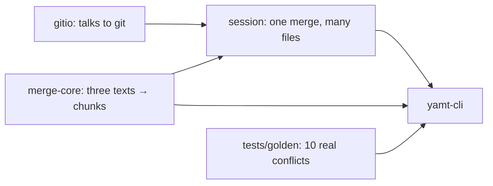

# M0 walkthrough — the Rust merge engine, headless

What exists after M0, how to try it, what we learned about git on the way, and the few Rust
constructs a TypeScript reader will not recognise at first sight.

## What was built



| crate           | job                                                                                                                          | the one thing to know                                                  |
| --------------- | ---------------------------------------------------------------------------------------------------------------------------- | ---------------------------------------------------------------------- |
| `merge-core`    | base + local + remote text → sorted list of chunks (`LocalOnly`, `RemoteOnly`, `BothSame`, `Conflict`)                       | pure: no files, no git; every chunk has a range in all three texts     |
| `gitio`         | runs git: list conflicted files with their three stages, read blobs, put stages back, `checkout -m`, `add`                   | bytes in, bytes out; every call has a 30 s deadline                    |
| `session`       | opens a merge, reads and decodes every conflicted file once, `finish` (write + `git add`), `reset` (bring the conflict back) | captures the three stages at open, so reset works even after `git add` |
| `conflict-repo` | builds throwaway git repos with scripted conflicts                                                                           | test-only; the one place tests make conflicts                          |
| `cli`           | `classify`, `scan`, `golden run/update`, `fixture`                                                                           | how you look at the engine without a window                            |

Files the window cannot show yet are listed with a reason instead of breaking the merge:
`Binary`, `NonUtf8`, `TooLarge`, `LocalDeleted`, `RemoteDeleted`, `Symlink`, `Submodule`.

## Try it

```sh
just smoke-cli                      # chunks of the window's sample file (7 chunks)
just golden-show vue-core-script-context
cargo run -q -p yamt-cli -- scan    # inside any repo that is mid-merge
just golden-repo nuxt-island-test /tmp/yamt-nuxt   # a real conflict to open in PhpStorm
```

A `classify` row reads `4 Conflict base[57+4] local[62+4] remote[53+2]`: chunk 4 is a conflict
covering base lines 57–60 (0-based, 4 lines), local lines 62–65 and remote lines 53–54.
PhpStorm counts lines from 1, so add 1 when comparing.

## What we learned about git

- **`git add` keeps a "resolve-undo" record.** `git checkout -m` can rebuild a conflict from it
  on its own, so a test that only does finish-then-reset passes even if yamt forgot the stages.
  The real test clears that record first (`git update-index --clear-resolve-undo`).
- **`git checkout -m` refuses some files**: a file deleted on one side ("does not have all
  necessary versions") and a submodule ("unable to read blob object"). Reset puts the stages
  back and skips that step for those files.
- **Two diff programs can disagree on repeated lines.** yamt uses a different diff library than
  git, so on runs of identical lines they can align changes differently and disagree on whether
  a region conflicts. The cross-check therefore compares yamt with git only when both find no
  conflict (242 of 512 generated cases: identical every time), and limits how often yamt calls
  something clean that git calls a conflict (0 of 512 today). yamt never applies a chunk by
  itself, so such a region would still be reviewed by you.

## Rust constructs worth a second look

**Newtypes for line numbers** (`merge-core/src/line.rs`). `BaseLine(u32)`, `LocalLine(u32)`,
`RemoteLine(u32)` are three different types that each hold one number. Passing a base line
where a local line is expected is a compile error — the merge tool's most common bug cannot be
written. The TS side gets the same with branded types.

**A range that cannot be backwards.** `LineRange { start, len }` stores a length, not an end,
so "end before start" is impossible to build.

**`partition_point`** (`merge-core/src/compute.rs`, `map_base_to_side`). On a sorted list it
returns how many items satisfy a condition — a binary search. `hunk.before.start < base.start`
counts the changes before a chunk starts; `<= base.end` counts the ones up to its end
(including an insertion exactly at the end). Those two counts turn a base line into the
matching local or remote line.

**`match` with a guard on "the last element"** (`compute.rs`, `sweep`):

```rust
match regions.last_mut() {
    Some(region) if base.start <= region.base.end.saturating_add(gap) => { /* grow it */ }
    Some(_) | None => regions.push(/* new region */),
}
```

`last_mut()` gives `Option<&mut Region>`: maybe a writable reference to the last region. The
`if` after the pattern only matches when the next change is close enough. `saturating_add`
stops at the largest `u32` instead of overflowing.

**No `unwrap`, so `Option` chains** (`compute.rs`, `side_line`):
`preceding_hunks.checked_sub(1).and_then(|index| self.hunks.get(index))` — "the hunk just
before, if there is one". `checked_sub` returns `None` instead of underflowing below 0, and
`get` returns `None` instead of crashing on a bad index. The lint config forbids `unwrap()`
outside tests, so every "can this be missing?" is answered in the code.

**Error enums with `thiserror` and `?`** (every crate's `lib.rs`). Each crate has one `Error`
enum whose variants name the cause (`GitFailed { args, status, stderr }`, `UnknownPath`, …).
`#[from]` lets `?` turn a lower crate's error into this crate's error, so
`self.repo.add(&file.path)?` either continues or returns early with the error.

**A deadline on a child process with plain threads** (`gitio/src/run.rs`). Git's output pipes
are read on two threads that send their bytes through a channel (`mpsc`). The main thread polls
`try_wait()` until git exits or the deadline passes (then `kill` and `wait`, so no zombie), and
then waits for each pipe with `recv_timeout(time left)`. Without the second part, a hook that
leaves a background process holding git's stderr open would block yamt forever.

**Paths are bytes** (`gitio/src/entry.rs`). Git paths are not guaranteed to be UTF-8, so they
are built with `OsStr::from_bytes` (Unix only, which is all yamt targets) and only turned into
text for display.

**Property tests** (`merge-core/tests/invariants.rs`). `proptest` generates hundreds of random
triples and checks rules that must always hold — e.g. replacing every chunk's base lines with
its local lines must give back the local text byte for byte. When a rule breaks, it shrinks
the input to the smallest failing example.

## Your check (milestone acceptance)

For each of the 10 cases in `tests/golden/` (see `tests/golden/README.md`), open the conflict in
PhpStorm (`just golden-repo <case> /tmp/yamt-<case>`, then Git → Resolve Conflicts → Merge, or
`phpstorm merge local.<ext> remote.<ext> base.<ext> <output>`) and compare its highlighted
blocks with `just golden-show <case>`: same number of blocks, same places, same kind (one side
only / both the same / conflict). Differences are expected where two changes sit one or two
lines apart — yamt currently joins changes separated by at most 1 unchanged line
(`DEFAULT_GAP = 1`); your comparison decides whether that should be 0.
